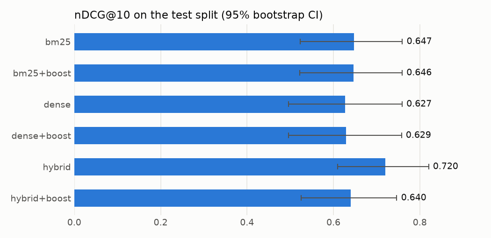

# Twitch Indexer

Search live Twitch chat for moments: "when did chat react to the boss fight on jynxzi" returns timestamped, cited 30-second chat windows with a link into the VOD at that second. Comes with a pooled, human-checked eval comparing BM25, dense, hybrid and chat-activity ranking.

## Quickstart

```
python -m venv .venv && .venv\Scripts\activate          # Windows (source .venv/bin/activate elsewhere)
pip install torch==2.14.1 --index-url https://download.pytorch.org/whl/cpu
pip install -r requirements.txt
copy .env.example .env                                     # add TWITCH_CLIENT_ID / TWITCH_CLIENT_SECRET (Helix only)

python -m twindex.collector          # leave running: chat history can't be fetched later (no credentials needed)
python -m twindex.helix poll         # leave running: live category per channel, every 5 min
python -m twindex.helix fetch        # VOD + clip metadata (cached)

python -m twindex index              # atomic rebuild (FTS5 + embeddings); --incremental to upsert new chat
python -m twindex search "chat losing it over a clutch" --channel jynxzi --method hybrid
python -m twindex search "drum gun" --json            # agent-friendly output, capped by --max-chars
python -m twindex get jynxzi:1791675420                # every message in one window
python -m twindex describe                             # field mapping and coverage
```

**MCP server** (stdio; tools `search`, `get_window`, `describe`, all read-only). To add it to Claude Code:

```
claude mcp add twitch-indexer -e PYTHONPATH=C:\path\to\twitch-indexer -- C:\path\to\twitch-indexer\.venv\Scripts\python.exe -m twindex.mcp_server
```

Over MCP, `search` defaults to `hybrid` (best in the eval). The CLI defaults to `bm25`, which answers instantly without loading the embedding model.

Channels are listed in `config.toml`. Usernames are salted-hashed at ingest, and raw chat never leaves `data/` (gitignored).

**Reproduce the eval:** `python -m twindex.eval` rebuilds the frozen corpus from raw chat and writes everything in `results/`. The labeled set lives in `eval/` (queries, TREC qrels, labels, checksums). The corpus itself is private chat, so the numbers reproduce only on the machine that collected it.

## Results (pilot)

42 queries over ~1.5 h of chat from 3 channels (455 windows). 12 dev / 30 test queries, pooled from the top 5 of every method. 154 labels were checked by a human, blind, with agreement Cohen's κ = 0.54 (quadratic 0.68). **Test split:**

| method | nDCG@10 (95% CI) | Recall@20 | MRR | judged@10 | p vs BM25 | p50 ms | p95 ms |
|---|---|---|---|---|---|---|---|
| bm25 | 0.647 (0.523–0.759) | 0.708 | 0.724 | 0.84 | — | 0.3 | 0.7 |
| bm25+boost | 0.646 (0.522–0.759) | 0.708 | 0.733 | 0.85 | 0.89 | 0.6 | 1.2 |
| dense | 0.627 (0.496–0.759) | 0.830 | 0.694 | 0.64 | 0.77 | 12.5 | 14.2 |
| dense+boost | 0.629 (0.495–0.758) | 0.813 | 0.688 | 0.65 | 0.79 | 12.8 | 14.1 |
| **hybrid** | **0.720 (0.609–0.820)** | **0.935** | **0.757** | 0.73 | **0.034** | 12.7 | 14.4 |
| hybrid+boost | 0.640 (0.525–0.747) | 0.931 | 0.715 | 0.69 | 0.87 | 13.2 | 14.3 |

Build: FTS5 0.2 s / 2.0 MB. Embeddings 25 s / 0.7 MB (bge-small, CPU). Latency excludes model load.



**Findings.**
- Hybrid RRF is the only method that beats BM25 significantly (+0.07 nDCG@10, p = 0.03, paired randomization test), with 0.94 recall@20. BM25 and dense fail on different queries, and fusion catches both.
- BM25 wins exact-term and event queries, where one rare word ("drum gun", "survives") in a busy 170-message window is decisive and gets diluted in a dense embedding.
- Dense wins slang and paraphrase, where chat's wording differs from the query ("coach" vs "teach", "67" vs "six seven").
- The chat-activity boost doesn't help these mostly topical queries (it costs hybrid 0.08). But it does pull top results toward viewer-clipped moments (top-1 clip overlap 0.53 → 0.61), and the loudest 2% of windows overlap a clip 100% of the time against a 50% base rate.
- This is a pilot: 30 test queries give wide CIs, and dense is probably underestimated (only 64% of its top 10 was judged).

Details: [failure analysis](results/failure_analysis.md) · [design decisions](DESIGN.md)

## Layout

```
twindex/collector.py   anonymous read-only IRC → data/chat/YYYY-MM-DD.jsonl
twindex/helix.py       VODs, clips, games (cached, rate-limited) + live-category poller
twindex/windows.py     30 s windows, activity z-scores, VOD offsets, game lookup
twindex/index.py       SQLite FTS5: atomic rebuild, incremental upsert, BM25
twindex/dense.py       bge-small-en-v1.5 + FAISS exact search with SQL filters
twindex/search.py      bm25 | dense | hybrid (RRF), optional activity boost
twindex/evalset.py     sample → pool → blind label → freeze
twindex/eval.py        metrics, significance, latency, clip alignment, chart
twindex/mcp_server.py  MCP tools over the same search and cards
```
